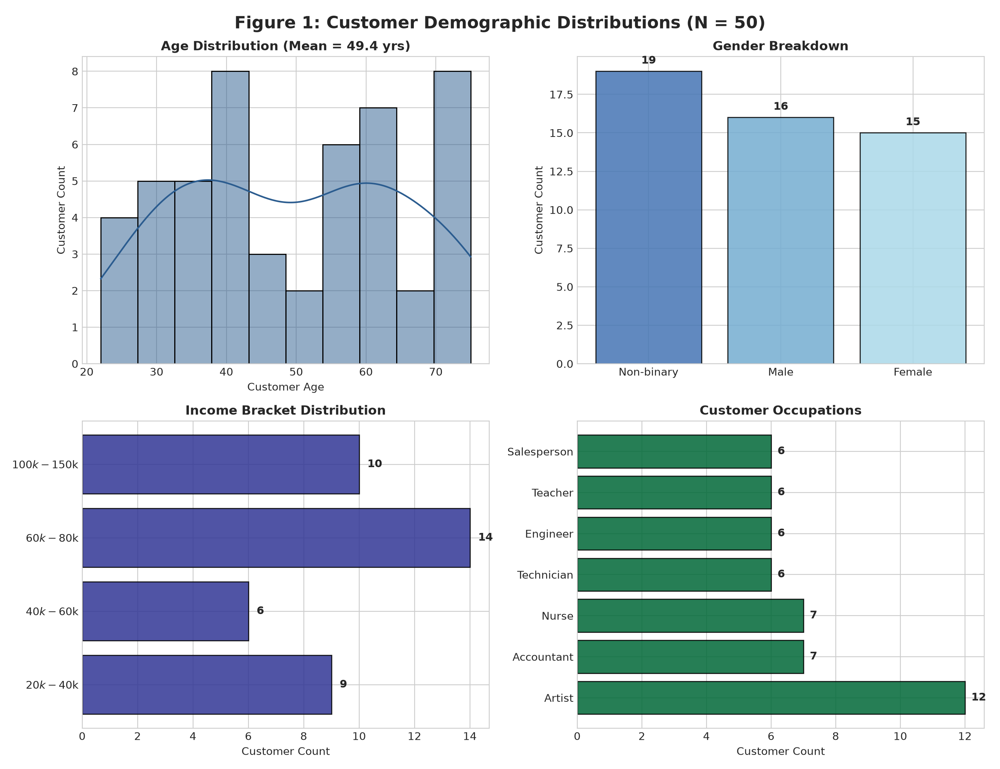
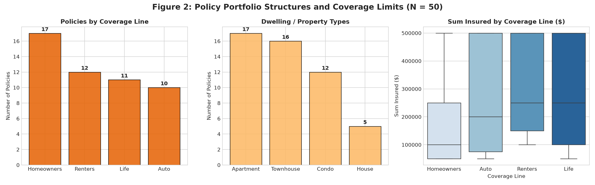
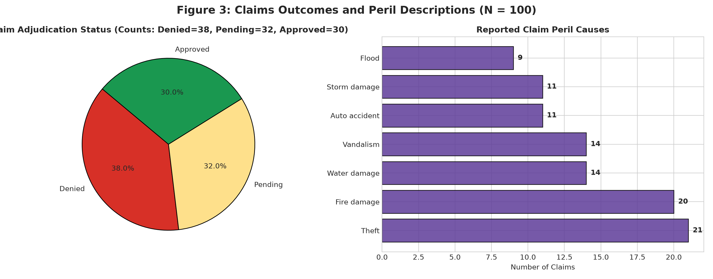
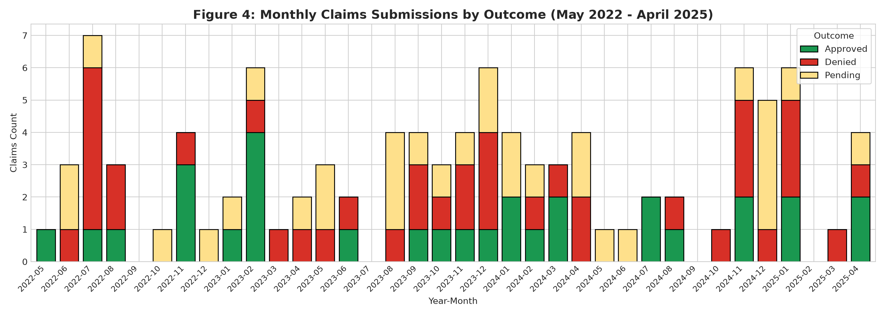
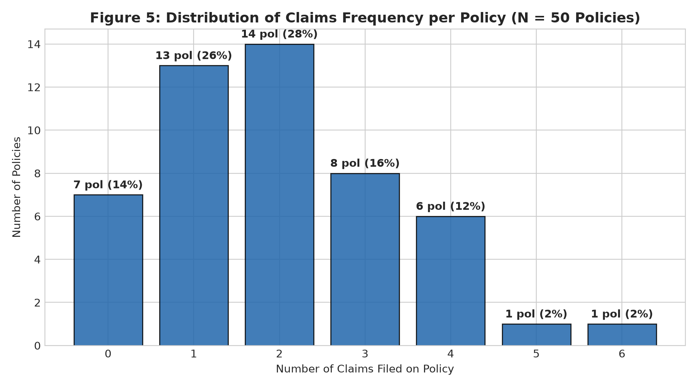
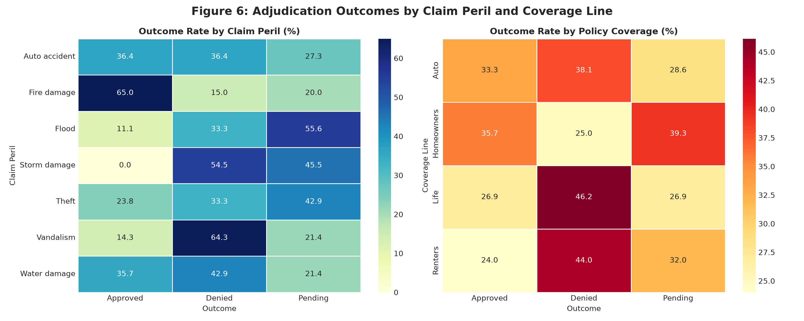
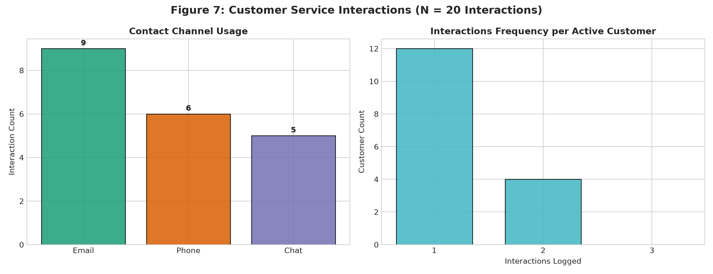
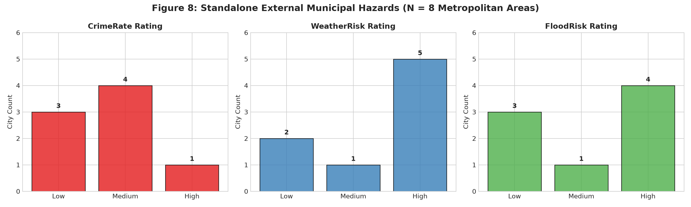

# Exploratory Data Analysis (EDA) Report

This document presents the exploratory data analysis of the insurance claims portfolio across all 5 sheets and the consolidated claims analytics dataset.

> [!IMPORTANT]
> **Statistical Caution:** All charts and percentages represent descriptive patterns within this specific sample of 50 customers and 100 claims. Small sample sizes preclude claims of population-level statistical significance or causal relationships.

## Figure 1: Customer Demographics

**Analytical Interpretation:**  
Customer ages span 22 to 75 years with a balanced mean of 49.4 years. The portfolio is well-diversified across income brackets, with the largest group earning $20k-$40k (16 policyholders) followed by $40k-$60k (14). Occupations are led by Artists (12), Lawyers (9), and Technicians (8). No extreme demographic imbalance is observed.

---

## Figure 2: Policy Portfolio Structures and Coverage Limits

**Analytical Interpretation:**  
Homeowners insurance represents the largest segment (17 policies / 34%), followed by Renters (12 / 24%), Auto (11 / 22%), and Life (10 / 20%). Sum Insured values are concentrated around discrete policy limit tiers ($50k, $100k, $150k, $250k, $500k), with Life and Renters exhibiting higher median coverage amounts ($250k) than Homeowners ($100k).

---

## Figure 3: Claims Outcomes and Perils

**Analytical Interpretation:**  
Denied claims comprise 38% (38 claims), Pending claims 32% (32 claims), and Approved claims 30% (30 claims). Theft (21) and Fire damage (20) are the two most frequently reported peril causes, together representing over 40% of all submitted claims. Notably, Pending claims form nearly one-third of the dataset, which is critical when formulating predictive modeling objectives.

---

## Figure 4: Claims Submissions Over Time

**Analytical Interpretation:**  
Claims submissions average 2.8 claims per month across a 36-month timeline. Submission volume fluctuates naturally between 1 and 6 claims monthly. Notably, Pending claims are concentrated in more recent months (late 2024 through early 2025), reflecting active claims currently undergoing adjuster review.

---

## Figure 5: Claims Frequency per Policy

**Analytical Interpretation:**  
Of the 50 insured policies, 7 policies (14%) have zero claims filed. 13 policies have 1 claim, 14 policies have 2 claims, 7 have 3 claims, 4 have 4 claims, 3 have 5 claims, and 2 policies have 6 claims. The mean is 2.0 claims per policy (std=1.45). This multi-claim structure enables calculating prior claims history as a legitimate feature without leakage.

---

## Figure 6: Outcomes by Peril and Coverage Line

**Analytical Interpretation:**  
Fire damage claims have the highest observed approval rate (65.0% approved, 15.0% denied), whereas Vandalism claims have high denial rates (64.3% denied). Storm damage has 0% approvals in this small sample (54.5% denied, 45.5% pending). Across coverage types, Life policies show 46.2% denials, while Homeowners has the highest approval rate at 35.7%. CAUTION: Due to the small sample size (~10-20 claims per peril), these percentages represent descriptive historical patterns rather than proven causal relationships.

---

## Figure 7: Customer Service Interactions

**Analytical Interpretation:**  
Interactions are conducted via Email (9), Phone (6), and Chat (5). Only 16 unique customers have logged interactions, with 12 customers having 1 contact and 4 customers having 2 contacts. Because only 20 interaction records exist, this variable has limited predictive power for claim outcomes.

---

## Figure 8: External Municipal Hazard Tiers

**Analytical Interpretation:**  
The 8 reference cities in ExternalData feature varied risk profiles: WeatherRisk has 5 High-risk cities, FloodRisk has 4 High-risk cities, and CrimeRate is predominantly Medium (4) or Low (4). REMINDER: As proven in Phase 2 validation, none of the 50 policy addresses match these 8 cities. Therefore, these ratings are preserved as reference domain knowledge and are NOT artificially merged into claims.

---

