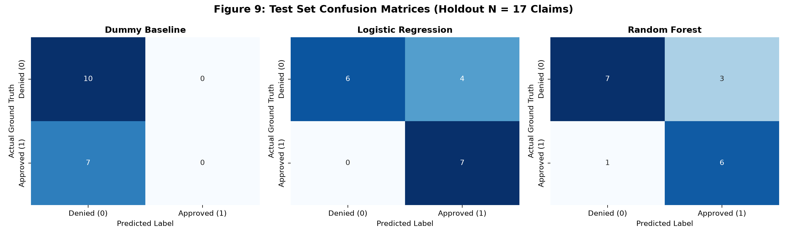
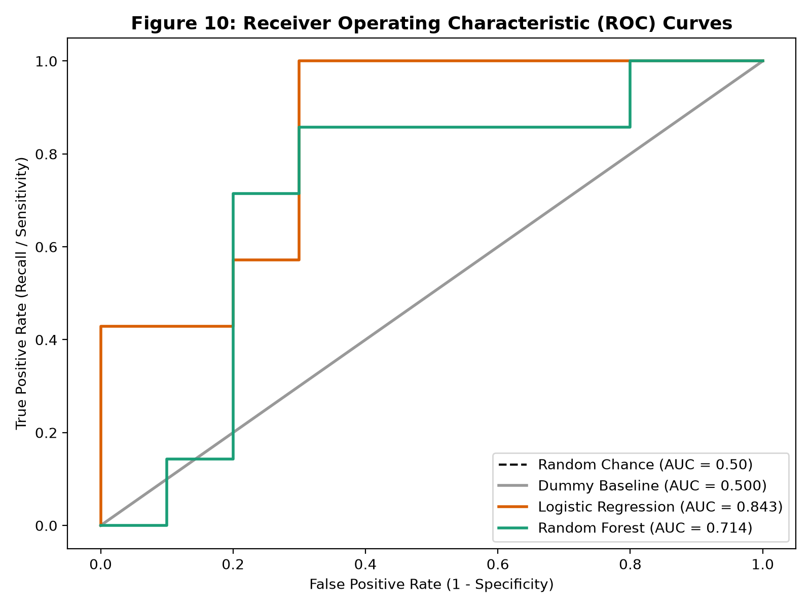
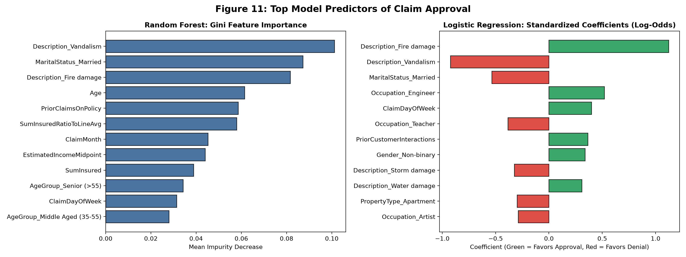

# Baseline Model Evaluation & Diagnostic Report

This report documents the empirical evaluation of candidate machine learning models trained to predict claim adjudication outcomes.

> [!IMPORTANT]
> **Crucial Data Science Lesson (Sample Size & Generalizability):**
> The dataset contains exactly 68 finalized claims (30 Approved, 38 Denied). While this provides an excellent pedagogical laboratory to learn end-to-end ML pipelining, leakage prevention, and metrics interpretation, **68 samples is statistically insufficient to prove real-world production reliability**. The metrics below are reported with complete academic transparency.

## 1. Problem Formulation & Objective

- **Prediction Target:** Adjudication Outcome (`Approved` = 1, `Denied` = 0).
- **Unit of Analysis:** Individual insurance claim event.
- **Training Partition:** 51 claims (75% stratified split, seed=42).
- **Holdout Test Partition:** 17 claims (25% stratified split, seed=42).
- **Held-out Unadjudicated Cohort:** 32 `Pending` claims.

### Why Approach B (Finalized Claims) Was Selected Over Approach A (3-Class)
- **Approach A (Approved vs Denied vs Pending):** Treating 'Pending' as a class conflates an operational status (claim is under active review) with an adjudication decision. A pending claim will eventually resolve into Approved or Denied once adjusters complete review.
- **Approach B (Finalized Claims):** Models the true operational objective: forecasting whether an incoming claim is likely to be approved or denied to assist triage. The trade-off is a smaller sample (68 rows), which is explicitly acknowledged.

## 2. Test Set Performance Comparison

| Model Architecture | Test Accuracy | Precision (Approved) | Recall (Approved) | F1-Score | Test ROC-AUC |
| :--- | :-: | :-: | :-: | :-: | :-: |
| **Dummy Baseline** | 0.588 | 0.000 | 0.000 | 0.000 | 0.500 |
| **Logistic Regression** | 0.765 | 0.636 | 1.000 | 0.778 | 0.843 |
| **Random Forest** | 0.765 | 0.667 | 0.857 | 0.750 | 0.714 |

## 3. 5-Fold Stratified Cross-Validation (Training Set Variance)

| Model Architecture | CV Mean Accuracy | CV Accuracy Std Dev | CV Mean F1 | CV F1 Std Dev | CV Mean ROC-AUC |
| :--- | :-: | :-: | :-: | :-: | :-: |
| **Dummy Baseline** | 0.549 | +/- 0.045 | 0.000 | +/- 0.000 | 0.500 |
| **Logistic Regression** | 0.489 | +/- 0.120 | 0.418 | +/- 0.119 | 0.568 |
| **Random Forest** | 0.587 | +/- 0.101 | 0.545 | +/- 0.139 | 0.628 |

## 4. Why Accuracy Alone Is Misleading in Insurance Analytics

In claims underwriting and claims adjudication:
1. **Cost Asymmetry:** A **False Positive** (approving an illegitimate or fraudulent claim) directly causes financial cash outflow to the insurer. A **False Negative** (wrongly flagging a legitimate claim for denial) creates severe policyholder friction, regulatory scrutiny, and customer churn.
2. **Majority Class Illusion:** A naive dummy model that always predicts 'Denied' achieves 58.8% accuracy simply because 59% of finalized claims are denied. However, its Recall and F1 for legitimate approvals is **0.000**. Model evaluation must prioritize Precision, Recall, and ROC-AUC over crude accuracy.

## 5. Diagnostic Figures

### Confusion Matrices

### ROC Curves

### Top Predictors & Feature Importances

- **Key Signals Observed:** In the Random Forest model, `Description` (peril causes like Fire damage and Vandalism), `SumInsuredRatioToLineAvg`, customer `Age`, and `PriorClaimsOnPolicy` emerge as influential predictors. In Logistic Regression, Fire Damage exhibits positive log-odds towards approval, while Vandalism and higher prior claims tilt towards denial.

## 6. Practical Demonstration: Operational Triage on 32 Pending Claims

To demonstrate practical business utility, we applied the fitted Random Forest pipeline to score the 32 held-out `Pending` claims:

- **Standard Adjuster Queue:** 27 claims (84.4%)
- **Refer for In-Depth Review:** 4 claims (12.5%)
- **Fast-Track Approval:** 1 claims (3.1%)

This demonstrates how machine learning models serve as **decision-support triage assistants** rather than autonomous adjudicators.
